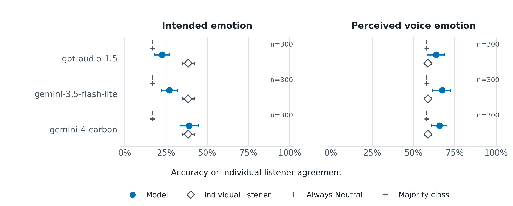
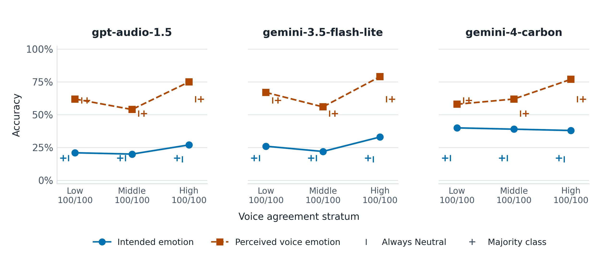
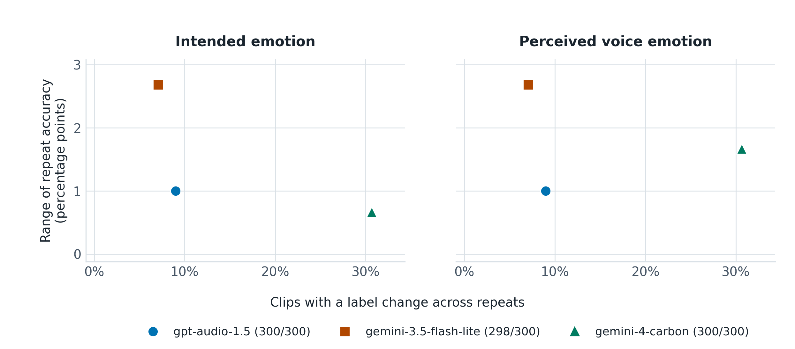

# Intended or Perceived?

**Draft for Gate 3 review.** This exploratory study evaluates three audio-capable models on 300 acted English clips from CREMA-D. Each model matched the voice-only listener plurality more often than the emotion the actor intended to portray. Across three identical prompt runs, individual labels changed more often than the aggregate accuracy ranges suggest. The study uses the crowd ratings reported by Cao et al. (2014) and model calls made November 14, 2026. It has not been peer reviewed. [Full results](results/analysis/RESULTS.md) · [Methods](docs/METHODS.md)

## Results

The primary analysis uses one surrounding Markdown fence allowance. The table reports P1-R1 accuracy, with strict-parser scores for comparison. All amended estimates use 300 clips. The strict Carbon estimates use 227 valid clips from 90 actors. Tied listener pluralities count as a match if the prediction is any of the tied labels.

| Served model ID | Amended intended / perceived | Strict intended / perceived | Amended paired gap [95% CI] | P1 clip-level flips, amended |
| --- | ---: | ---: | ---: | ---: |
| `gpt-audio-1.5` | 22.7% / 63.7% | 22.7% / 63.7% | +41.0 pp [35.3, 46.4] | 9.0% of 300 |
| `gemini-3.5-flash-lite` | 27.0% / 67.3% | 27.0% / 67.3% | +40.3 pp [34.1, 46.0] | 7.0% of 298 |
| `gemini-4-carbon` | 39.0% / 65.7% | 38.3% / 66.5% | +26.7 pp [20.1, 33.0] | 30.7% of 300 |

For the 300-clip subset, the always-Neutral baseline was 16.7% intended and 58.0% perceived. The majority-class baseline was also 16.7% and 58.0% (Anger and Neutral respectively, with the intended class tie broken in prespecified order). On Carbon’s strict subset the always-Neutral baseline was 16.7% / 59.0%, and the majority-class baseline was Happy 17.2% / Neutral 59.0%. [Baselines and per-reference intervals](results/analysis/primary_accuracy.csv)

The [results index](results/analysis/RESULTS.md) includes confusion matrices, macro-F1, MCC, human agreement and confidence, forecast divergence, stability, and strict sensitivity tables. The [exploratory format checks](results/analysis/FORMAT_CHECKS.md) compare Carbon’s fenced and unfenced label counts and document the eight OpenAI P3 prose responses.

## Limitations

- The recordings are scripted, acted English speech from one dataset. Agreement with these listeners measures correspondence to their vote labels under the study conditions. The design cannot establish validity for real-world emotion recognition.
- The sample balances intended emotions and agreement strata, which sets the class proportions used in the baselines. Results should be interpreted for this mixture. Of the 300 clips, 276 have unspecified intended intensity. The other intensity groups are small.
- The perceived model reference uses the full panel, and the individual-listener baseline leaves out the evaluated listener. The exact-match estimates have different reference construction. The human comparison is descriptive.
- Carbon used provider-default `medium` thinking and a 1,024-token output cap that includes thinking. The other models used 256-token caps. Flash-Lite’s provider default is `minimal` thinking, and the OpenAI calls used the audio Chat Completions defaults. The comparison is between these model configurations. [Source lock](SOURCE_LOCK.md)
- Strict parsing excludes 277 Carbon main-run responses that the amended parser can score. Both coverage and metrics are reported under each rule and its valid subset. The strict sensitivity therefore combines formatting exclusion with a change in the clips evaluated.

## Reproduce locally

The analysis and figures run offline from the saved main-run transcripts and pinned ratings. The derived tables are included here for inspection. The raw transcripts and media stay in the ignored local folders. [Reproduction commands and inputs](docs/METHODS.md#reproduce-the-analysis)

Code is available under [MIT](LICENSE). The manifest and derived tables based on CREMA-D are attributed to CREMA-D and distributed under ODbL 1.0 with the source contents under DbCL 1.0. Cite Cao, Cooper, Keutmann, Gur, Nenkova, and Verma (2014), *IEEE Transactions on Affective Computing*, 5(4), 377–390. [Data provenance and license](data/README.md) · [Paper DOI](https://doi.org/10.1109/TAFFC.2014.2336244)

AI coding agents assisted implementation under Zack van Allen’s direction. Zack set the design and analysis decisions. The conclusions and public wording are pending his Gate 3 review.
